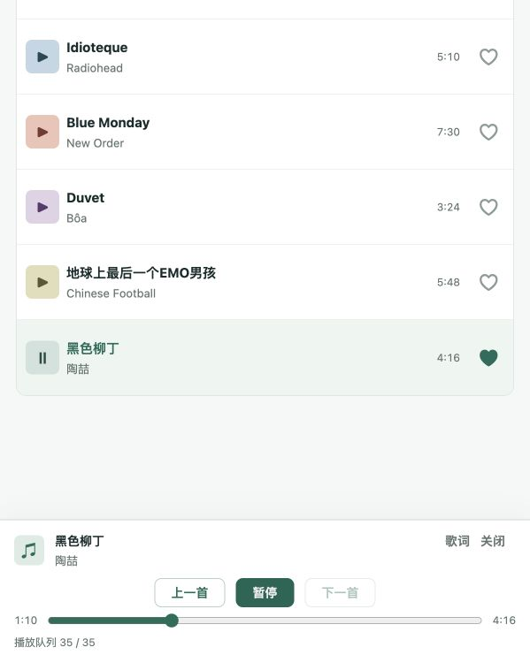

# 喜欢操作与页面滚动修复

2026-11-24，修复歌单详情中喜欢歌曲后跳转到曲库顶部的问题，并检查相邻操作。

## 原因与修改

第一次修复只处理前端无条件滚动到顶部。进一步排查发现，歌曲喜欢接口仅区分“曲库”和“我的音乐”，歌单详情、推荐页的表单会默认返回曲库，因此未进入前端的同页滚动恢复逻辑。修复前的真实请求返回 `/songs?q=`，而来源是歌单详情。

本次所有歌曲喜欢表单增加 `return_path`，传回当前路径和查询条件。后端只接受曲库、我的音乐、发现同好及歌单详情四类现有 GET 路由，拒绝外站、双斜线、反斜线、控制字符及其他接口地址；旧表单仍兼容原有 `return_to` 和 `q` 参数。会话、CSRF 与歌曲存在性校验保持有效。

前端在同页保存后恢复滚动坐标，保留已展开的编辑面板，并尽量将焦点留在原歌曲的喜欢按钮上。若取消喜欢导致该行从个人列表消失，焦点回到主内容且不主动滚动；文档变短时允许浏览器将位置限制在新的页面底部。正常跨页导航仍从顶部开始。

## 验证

后端使用真实 openGauss、独立账号和歌单验证四种来源页面的喜欢、取消及重复提交，同时检查返回地址限制、旧表单、CSRF、未登录和失效歌曲。测试代码为 `tests/like_navigation.py`，结束后清理临时记录。

公网浏览器完成以下 12 类操作：

| 操作 | 验证结果 |
|---|---|
| 公开歌单内喜欢，且音频正在播放 | 地址保留，滚动 3369 → 3369；音频继续且仍只有一个 audio |
| 公开歌单内取消喜欢 | 3369 → 3369 |
| 收藏歌单、取消收藏 | 两项均为 334 → 334 |
| 曲库喜欢、取消喜欢 | 两项均为 3282 → 3282 |
| 推荐歌曲喜欢 | 保留发现同好页，1698.5 → 1698.5 |
| 个人列表取消喜欢 | 744 → 744，资料编辑面板仍展开 |
| 歌单内下移、移除 | 两项位置保留，编辑面板仍展开，排序与收录结果正确 |
| 曲库弹窗添加到歌单 | 2890.5 → 2890.5，仍停留曲库 |
| 过滤曲库中的喜欢 | 367 → 367，搜索词 Porter 保留 |

图中为明确标注的临时回归歌单。测试结束后，两位临时用户、两张歌单、收录及喜欢关系均已清理，原有用户偏好未被测试脚本修改。

## 发布

代码同步到 ECS，并重启 Gunicorn 所在的 music-platform 服务；核对本地与服务器的三个运行文件 SHA256 相同。GitHub 同步更新应用代码、回归测试和本记录。已打开的旧页面需要刷新，以加载新的模板和 JavaScript。

服务器代码回退包：`/opt/music-platform/backups/scroll-navigation/before.tar.gz`。必要时恢复其中三个应用文件并重启 music-platform；本次未迁移数据库结构。
