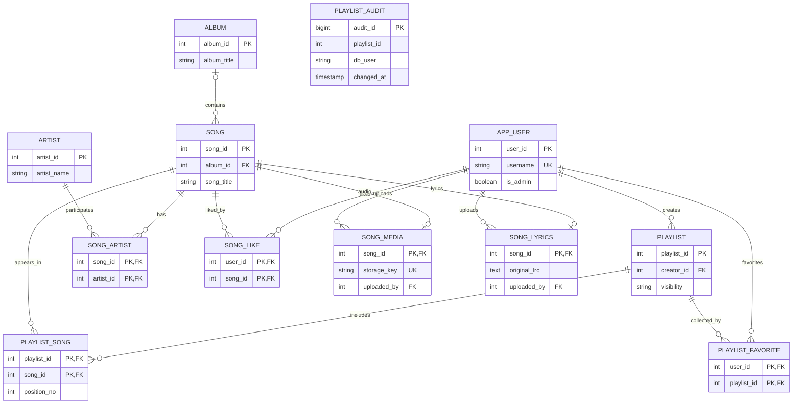

# 《数据库应用实践》实验三：数据库应用系统的开发

**项目名称：同频——音乐歌单分享平台**

学号：102403130　姓名：黄佳鹏　专业：计算机科学与技术　班级：数智班

实验日期：2026年11月23日—24日

**实验环境：**

| 项目 | 配置 |
|---|---|
| 服务器 | 华为云 ECS，aarch64 架构，约 3 GB 内存 |
| 操作系统 | openEuler 20.03 LTS |
| 数据库 | openGauss 5.0.1；数据库 music_platform；模式 music |
| 数据库连接 | 应用通过服务器本机 127.0.0.1:26000 连接数据库 |
| 后端 | Python 3.12.16、Flask 3.1.3、Werkzeug 3.1.9 |
| 数据库驱动 | py-opengauss 1.3.11 |
| 页面技术 | Jinja 模板、HTML、CSS、原生 JavaScript |
| Web 服务 | Nginx 1.30.8、Gunicorn 27.0.1、systemd |
| 媒体处理 | ffprobe 7.0.2；HTML audio；LRC 时间轴解析 |
| 开发与访问方式 | Mac 本地开发，随后部署到 ECS；浏览器访问服务器 Web 页面 |

## 一、系统选题需求及任务分工

### 1.1 选题与应用场景

本次沿用前两次实验的音乐平台数据库，开发音乐歌单分享平台“同频”。选题重点是歌单整理、用户分享和听歌偏好相似度。用户从曲库中寻找歌曲，标记喜欢，将歌曲收录到自己的歌单；其他用户可以收藏公开歌单，也可以根据共同喜欢的歌曲寻找同好。

系统采用 B/S 结构。用户在浏览器操作页面，Flask 验证身份并访问 openGauss，再将查询或维护结果显示在页面上。最终版本还支持真实音频播放、管理员上传和逐行同步歌词，使歌曲资料、用户偏好和实际听歌操作能够对应起来。

### 1.2 用户角色与功能需求

平台角色与数据库账号分别管理。游客可以浏览公开内容；普通用户可以维护自己的资料和歌单；曲库管理员负责歌曲、音频和歌词。普通用户注册后不会自动获得管理权限。

| 角色 | 主要需求 | 涉及的数据 |
|---|---|---|
| 游客 | 浏览和搜索歌曲、查看公开歌单、播放音乐 | song、artist、album、playlist、song_media、song_lyrics |
| 普通用户 | 注册登录、喜欢歌曲、创建和整理歌单、收藏公开歌单、查看同好 | app_user、song_like、playlist_song、playlist_favorite |
| 曲库管理员 | 新增歌曲和合作音乐人、关联专辑、上传替换音频与歌词 | app_user.is_admin、song_artist、song_media、song_lyrics |

插入、删除、修改、查询和统计查询均有对应操作。例如创建歌单执行插入，移除收录记录执行删除，编辑简介执行更新，搜索执行多表查询，歌单首数、总时长和同好排行则使用聚合与集合计算。

### 1.3 完成内容与个人分工

本项目按个人项目完成，需求整理、数据库适配、后端接口、页面交互、测试、部署和报告均纳入本人工作范围，不设置虚构的组员或工作量比例。实验一的关系设计和实验二的存储过程、触发器继续使用，本次重点是将其接入 Web 应用。

最终实现账号管理、曲库搜索、歌曲喜欢、歌单增删改、收录排序、公开分享、歌单收藏及同好推荐；扩展实现管理员曲库维护、跨页面播放和同步歌词。审核后台未实现，不作为已完成功能。

## 二、系统概念数据模型设计

### 2.1 实体与联系

系统以用户、音乐人、专辑、歌曲和歌单为主要实体。用户可以创建多张歌单，每张歌单只有一位创建者；一首歌可以有多位合作音乐人，也可以同时出现在多张歌单中，因此分别设置歌曲—音乐人和歌单—歌曲关联表。

用户喜欢歌曲与用户收藏歌单是两种不同关系。前者记录在 song_like 中，用于个人列表与同好计算；后者记录在 playlist_favorite 中，作为歌单分享的收藏关系，不能混为同一类数据。



### 2.2 关系设计中的处理

歌曲的 album_id 允许为空，表示暂未关联专辑的单曲。Shelter 使用这一设计，查询时采用 LEFT JOIN 保留该歌曲，再将空专辑显示为“独立单曲”。合作音乐人通过关联表聚合展示，避免一首歌因两位音乐人而显示两行或重复统计时长。

playlist_song 同时保存 position_no，表示同一歌单内的播放顺序。联合主键限制歌曲不能在同一歌单重复出现，另设歌单内位置唯一约束。song_like 和 playlist_favorite 也使用联合主键，分别限制重复喜欢和重复收藏。

音频文件保存在服务器媒体目录，数据库只保存文件信息；体积较小的 LRC 歌词则直接保存为文本。歌单审计表保存修改前后的信息，不设置到歌单主表的外键，因而删除歌单后仍可保留审计历史。图中审计表单独列出，未将逻辑上的歌单编号画成实际外键。

## 三、系统各表说明

### 3.1 用户表 app_user

用户表保存身份与个人资料。本次在实验一的字段上增加 password_hash 和 is_admin，用于密码登录与曲库管理员判断。以下各表中的 PK 表示主键，FK 表示外键，UK 表示唯一约束；时间字段均为 TIMESTAMP。

| 字段 | 类型与约束 | 用途 |
|---|---|---|
| user_id | INTEGER，PK，序列默认值 | 用户编号 |
| username | VARCHAR(50)，非空，UK | 登录用户名 |
| nickname | VARCHAR(50)，非空 | 页面显示昵称 |
| bio | VARCHAR(300)，可空 | 个人简介 |
| created_at | TIMESTAMP，非空，默认当前时间 | 注册时间 |
| password_hash | VARCHAR(256)，可空 | 密码哈希，未初始化的旧账号不能密码登录 |
| is_admin | BOOLEAN，非空，默认 false | 平台曲库管理员标志 |

注册时由 Werkzeug 生成密码哈希，登录时验证哈希，不保存明文密码。普通注册接口不接收管理员标志，应用数据库角色也没有该列的写入权限。

### 3.2 音乐人表 artist

音乐人既可以是个人，也可以是乐队。与歌曲的合作关系由 song_artist 保存，音乐人表本身不重复保存歌曲信息。

| 字段 | 类型与约束 | 用途 |
|---|---|---|
| artist_id | INTEGER，PK，序列默认值 | 音乐人编号 |
| artist_name | VARCHAR(100)，非空 | 音乐人名称 |
| artist_type | VARCHAR(10)，非空，限定 solo、band | 个人或乐队 |

### 3.3 专辑表 album

专辑表保存名称、发行日期和介绍。资料尚未提供的日期保持空值，不用推测的日期填充。

| 字段 | 类型与约束 | 用途 |
|---|---|---|
| album_id | INTEGER，PK，序列默认值 | 专辑编号 |
| album_title | VARCHAR(150)，非空 | 专辑名称 |
| release_date | DATE，可空 | 发行日期 |
| description | VARCHAR(500)，可空 | 专辑介绍 |

### 3.4 歌曲表 song

歌曲表保存不依赖具体用户的基础资料。绑定真实音频后，将实际时长向上取整为秒，更新 duration_seconds，供列表显示及歌单汇总使用。

| 字段 | 类型与约束 | 用途 |
|---|---|---|
| song_id | INTEGER，PK，序列默认值 | 歌曲编号 |
| song_title | VARCHAR(150)，非空 | 歌曲名称 |
| album_id | INTEGER，可空，FK → album | 所属专辑 |
| duration_seconds | INTEGER，非空，大于 0 | 歌曲时长（秒） |
| genre | VARCHAR(40)，非空，默认 Other | 曲风 |

歌名不是唯一键，同名歌曲可能由不同音乐人演唱。管理接口新增歌曲时，结合规范化歌名和完整音乐人集合检查重复。

### 3.5 歌曲音乐人表 song_artist

该表解决歌曲与音乐人的多对多关系。例如 Shelter 与 Porter Robinson、Madeon 分别关联，但歌曲主表只保留一条记录。

| 字段 | 类型与约束 | 用途 |
|---|---|---|
| song_id | INTEGER，联合 PK，FK → song | 歌曲编号 |
| artist_id | INTEGER，联合 PK，FK → artist | 音乐人编号 |

### 3.6 歌单表 playlist

歌单由用户创建，公开或私密决定其他用户能否读取。cover_url 沿用实验一的字段，当前页面封面由 CSS 绘制，没有使用该字段加载图片。

| 字段 | 类型与约束 | 用途 |
|---|---|---|
| playlist_id | INTEGER，PK，序列默认值 | 歌单编号 |
| creator_id | INTEGER，非空，FK → app_user | 创建者 |
| playlist_name | VARCHAR(100)，非空 | 歌单名称 |
| description | VARCHAR(1000)，可空 | 歌单简介 |
| visibility | VARCHAR(10)，非空，限定 public、private | 可见性 |
| created_at | TIMESTAMP，非空，默认当前时间 | 创建时间 |
| cover_url | VARCHAR(300)，可空 | 预留封面地址 |

### 3.7 歌单歌曲表 playlist_song

歌曲收录与顺序保存在关联表中，移除歌曲只删除该收录关系，不删除曲库歌曲及其他用户的关联记录。

| 字段 | 类型与约束 | 用途 |
|---|---|---|
| playlist_id | INTEGER，联合 PK，FK → playlist | 所属歌单 |
| song_id | INTEGER，联合 PK，FK → song | 收录歌曲 |
| position_no | INTEGER，非空，大于 0 | 歌单内顺序 |
| added_at | TIMESTAMP，非空，默认当前时间 | 收录时间 |

除联合主键外，UNIQUE(playlist_id, position_no) 保证同一歌单内位置不重复。调整顺序时需要在事务内处理这一约束，不能直接逐条交换两个位置。

### 3.8 歌曲喜欢表 song_like

喜欢关系是用户偏好的主要输入，个人喜欢列表、共同喜欢数和推荐候选都从该表读取。

| 字段 | 类型与约束 | 用途 |
|---|---|---|
| user_id | INTEGER，联合 PK，FK → app_user | 喜欢歌曲的用户 |
| song_id | INTEGER，联合 PK，FK → song | 被喜欢的歌曲 |
| liked_at | TIMESTAMP，非空，默认当前时间 | 喜欢时间 |

### 3.9 歌单收藏表 playlist_favorite

歌单收藏只记录用户与歌单的关系，不复制歌单内容。取消收藏不会影响创建者和其他收藏者。

| 字段 | 类型与约束 | 用途 |
|---|---|---|
| user_id | INTEGER，联合 PK，FK → app_user | 收藏者 |
| playlist_id | INTEGER，联合 PK，FK → playlist | 被收藏的歌单 |
| favorited_at | TIMESTAMP，非空，默认当前时间 | 收藏时间 |

### 3.10 音频关联表 song_media

本次新增此表，将已有歌曲与实际音频关联。song_id 同时是主键和外键，每首歌最多对应一份当前音频；替换文件不改变歌曲编号及原有喜欢、收录关系。

| 字段 | 类型与约束 | 用途 |
|---|---|---|
| song_id | INTEGER，PK，FK → song | 对应歌曲 |
| storage_key | VARCHAR(64)，非空，UK | 服务器生成的随机文件名 |
| original_name | VARCHAR(255)，非空 | 上传文件原名 |
| mime_type | VARCHAR(80)，非空 | 媒体类型 |
| byte_size | BIGINT，非空，大于 0 | 文件字节数 |
| duration_seconds | NUMERIC(12,3)，非空，大于 0 | 音频实际时长 |
| sha256 | CHAR(64)，非空 | 文件校验值 |
| uploaded_by | INTEGER，非空，FK → app_user | 上传者 |
| uploaded_at | TIMESTAMP，非空，默认当前时间 | 上传时间 |

随机存储名与原始文件名分离，避免用户文件名成为服务器路径。SHA256 用于导入去重和迁移核验，不作为歌曲身份编号。

### 3.11 歌词表 song_lyrics

歌词通过歌曲编号关联，保存原文 LRC 和可选翻译。数据库保留原始文本，后端解析时间标签，再向浏览器提供逐行显示的数据。

| 字段 | 类型与约束 | 用途 |
|---|---|---|
| song_id | INTEGER，PK，FK → song | 对应歌曲 |
| original_lrc | TEXT，非空 | 带时间标签的原文歌词 |
| translated_lrc | TEXT，可空 | 翻译歌词 |
| original_name | VARCHAR(255)，非空 | 原文歌词文件名 |
| uploaded_by | INTEGER，非空，FK → app_user | 上传者 |
| updated_at | TIMESTAMP，非空，默认当前时间 | 最近写入时间 |

没有翻译时仍显示原文，没有歌词时仍能播放音频。歌词读取一次后由浏览器根据播放进度高亮，不会每播放一句就查询数据库。

### 3.12 歌单审计表 playlist_audit

审计表沿用实验二的设计。歌单 UPDATE 后，触发器保存修改前后的名称、简介和可见性，作为维护记录。

| 字段 | 类型与约束 | 用途 |
|---|---|---|
| audit_id | BIGINT，PK，序列默认值 | 审计记录编号 |
| playlist_id | INTEGER，非空，无歌单外键 | 发生修改的歌单编号 |
| old_name、new_name | VARCHAR(100)，可空 | 修改前后名称 |
| old_description、new_description | VARCHAR(1000)，可空 | 修改前后简介 |
| old_visibility、new_visibility | VARCHAR(10)，可空 | 修改前后可见性 |
| db_user | VARCHAR(100)，非空 | 执行操作的数据库身份 |
| changed_at | TIMESTAMP，非空，默认当前时间 | 修改时间 |

这里记录的数据库身份是统一应用账号 music_web，并不能直接区分平台中的实际操作者。后续若增加精细审计，需要另存平台用户编号。

## 四、运行环境、安装与数据库连接

### 4.1 系统结构与服务器部署

应用采用 Flask 服务端模板渲染，不是前后端分别部署的单页应用。JavaScript 负责歌曲操作、局部导航和播放器；歌词使用 JSON 接口。浏览器请求经过 Nginx 转发到仅监听回环地址的 Gunicorn，再由 Flask 访问同机 openGauss。

```text
浏览器 → Nginx :80 → Gunicorn 127.0.0.1:5001
                         ↓ Flask / py-opengauss
                   openGauss 127.0.0.1:26000
                         ↓
                 music_platform / music
```

开发阶段在 Mac 上运行 Flask，经受限 SSH 隧道连接 ECS 数据库，验证参数查询、中文和事务回滚后再开发业务。部署时使用独立 Python 3.12 环境，保留服务器系统 Python；应用放在 /opt/music-platform/current，音频放在独立 media 目录，以无登录权限的 musicapp 用户运行。

安装及运行的关键命令如下，依赖安装在应用虚拟环境内。配置文件提供数据库用户、密码、会话密钥和媒体路径，不将实际密码写入源码或报告。

```sh
/opt/music-platform/tools/uv venv --python 3.12 /opt/music-platform/venv
/opt/music-platform/tools/uv pip install \
  --python /opt/music-platform/venv/bin/python -r requirements-server.txt
/opt/music-platform/venv/bin/gunicorn \
  --workers 2 --threads 2 --bind 127.0.0.1:5001 --timeout 120 run:app
systemctl enable --now music-platform nginx music-db-local-only
```

正式运行由 systemd 管理，不依赖 SSH 终端持续打开。Nginx 配置反向代理和上传大小限制；数据库客户端端口增加非回环接口拒绝规则，保留本机连接与原有 SSH 隧道使用方式。当前公网入口仍为 HTTP，尚未配置 HTTPS。

### 4.2 数据适配与资料准备

原有用户、音乐人、专辑、歌曲和歌单的手工编号保留，通过序列为新记录生成默认编号。序列从已有最大值之后开始，避免覆盖实验一、二的数据。以下以歌单为例，迁移只执行一次。

```sql
CREATE SEQUENCE music.playlist_id_seq;
SELECT setval('music.playlist_id_seq',
              COALESCE((SELECT MAX(playlist_id) FROM music.playlist),0)+1,
              false);
ALTER TABLE music.playlist ALTER COLUMN playlist_id
    SET DEFAULT nextval('music.playlist_id_seq');
```

曲库扩充清单有 30 个条目，其中 Shelter、Look at the Sky 和新宝岛复用原有歌曲，其余新增 27 首，使曲库达到 35 首。按分类建立五张公开歌单，分别收录 8、5、7、5、5 首歌曲。分类歌单简介按音乐内容分别编写，不保留导入文件名等内部说明。

音频目录中有 36 个 MP3，去除 Never Be Like You 的重复版本后，对应 35 首歌曲。《新月余晖》映射日文文件《三日月サンセット》，保留原 song_id 和中文显示名。导入前规范化 Unicode 并核对歌名、音乐人和明确别名，未修改用户原有喜欢关系。

结构与数据修改前使用 gs_dump 备份，并曾恢复到独立检查库核验。最终部署还逐一对比服务器 35 份音频的大小和 SHA256；音乐文件不在 SQL 备份中，因此媒体目录需要单独保存。

### 4.3 参数化连接与请求事务

后端使用 py-opengauss 连接服务器本机数据库，参数通过 prepare 绑定。下面是实际连接与查询方式的简化示例，配置中的 DB_PORT 在服务器设为 26000。

```python
connection = py_opengauss.open(
    f"pq://{config['DB_USER']}@127.0.0.1:{config['DB_PORT']}/{config['DB_NAME']}",
    password=config['DB_PASSWORD'],
    sslmode="disable"
)
statement = connection.prepare(
    "SELECT song_id, song_title FROM music.song WHERE song_title=$1"
)
rows = statement("Shelter")
```

这里数据库连接位于服务器本机回环网络，开发阶段跨机器的连接则封装在 SSH 隧道内。它与浏览器到网站的 HTTP 连接是两个不同环节，当前网站本身尚未启用 TLS。

每个需要数据库的请求先执行 BEGIN，响应状态小于 400 时提交，失败响应回滚；提交异常也会尝试回滚并返回失败提示，最后关闭连接。这样添加收录、调整顺序、删除歌单等多条 SQL 可以作为一次操作完成，不留下只执行一半的结果。

### 4.4 查询与增删改实现

搜索不仅匹配歌名，也匹配专辑与合作音乐人。以下为查询条件的核心部分，$1 是包含搜索词的绑定参数，空专辑不会使歌曲从结果中消失。

```sql
SELECT s.song_id, s.song_title,
       COALESCE(a.album_title, '独立单曲') AS album_title
FROM music.song s
LEFT JOIN music.album a ON a.album_id=s.album_id
WHERE s.song_title ILIKE $1 OR a.album_title ILIKE $1
   OR EXISTS (
       SELECT 1 FROM music.song_artist sa
       JOIN music.artist ar ON ar.artist_id=sa.artist_id
       WHERE sa.song_id=s.song_id AND ar.artist_name ILIKE $1
   )
ORDER BY s.song_id;
```

新建歌单时，creator_id 从登录会话取得，不能由表单指定他人身份。编辑和删除前，后端重新验证创建者并锁定歌单。下表列出代表性操作，SQL 的参数均由后端绑定。

| 页面操作 | 数据库操作 |
|---|---|
| 创建歌单 | INSERT INTO music.playlist(creator_id,playlist_name,description,visibility) VALUES($1,$2,$3,$4) RETURNING playlist_id |
| 修改歌单 | UPDATE music.playlist SET playlist_name=$1,description=$2,visibility=$3 WHERE playlist_id=$4 |
| 修改个人资料 | UPDATE music.app_user SET nickname=$1,bio=$2 WHERE user_id=$3 |
| 移除歌单中的歌曲 | DELETE FROM music.playlist_song WHERE playlist_id=$1 AND song_id=$2 |
| 取消喜欢 | DELETE FROM music.song_like WHERE user_id=$1 AND song_id=$2 |
| 取消收藏 | DELETE FROM music.playlist_favorite WHERE user_id=$1 AND playlist_id=$2 |

喜欢歌曲时先锁定当前用户记录，检查关系不存在再插入；收藏歌单时锁定歌单后检查插入，联合主键进一步限制重复关系。删除整张歌单则在同一事务中依次删除收藏、收录和歌单主记录，满足外键约束。

### 4.5 存储过程、排序与审计

添加歌曲沿用实验二的存储过程。接口先确认歌单归属与歌曲存在，并检查是否已经收录，再执行调用；重复请求直接返回已有状态。

```python
query('CALL music.add_song_to_playlist($1,$2,$3)',
      current_user_id, playlist_id, song_id)
```

调整顺序时先锁定歌单，将现有位置移到大于当前最大值的临时区间，再按最终列表写回 1、2、3 等位置。例如交换第 1、2 首时，不能先直接把 1 改成 2，否则会与尚未移动的第 2 首冲突。两个阶段都在同一事务中，失败后恢复原顺序。

歌单编辑由实验二的 AFTER UPDATE 触发器自动记录，无需前端另外发送审计请求。数据库中的实际触发器定义如下。

```sql
CREATE TRIGGER trg_playlist_update_audit
AFTER UPDATE ON music.playlist
FOR EACH ROW EXECUTE PROCEDURE music.audit_playlist_update();
```

报告核验时审计表有 7 条记录。应用角色可为触发器写入审计，但不能查询或删除审计；核验由数据库管理员完成，没有为页面展示临时扩大审计权限。

### 4.6 统计查询与同好推荐

歌单统计分别计算收录数量、时长和收藏数，避免同时连接多张一对多关联表造成行数相乘。下面的查询对应图4中歌单的数量与总时长。

```sql
SELECT p.playlist_name,
       (SELECT count(*) FROM music.playlist_song ps
        WHERE ps.playlist_id=p.playlist_id) AS song_count,
       COALESCE((SELECT sum(s.duration_seconds)
                 FROM music.playlist_song ps
                 JOIN music.song s ON s.song_id=ps.song_id
                 WHERE ps.playlist_id=p.playlist_id),0) AS seconds,
       (SELECT count(*) FROM music.playlist_favorite f
        WHERE f.playlist_id=p.playlist_id) AS favorites
FROM music.playlist p
WHERE p.playlist_id=$1;
```

“在耳机里，走远一点”收录 Shelter 和新宝岛，时长分别为 219、305 秒，合计 524 秒，即 8:44。Shelter 虽有两位音乐人，统计仍只累计一次。

同好计算只使用 song_like。令 A、B 为两名用户喜欢的歌曲编号集合，相似度为 J(A,B)=|A∩B|÷|A∪B|。SQL 使用公共表表达式统计本人歌曲集合、对方喜欢数和交集数，再计算比值；任一用户没有喜欢记录时返回 NULL，页面显示“数据不足”。

```sql
WITH mine AS (
    SELECT song_id FROM music.song_like WHERE user_id=$1
), counts AS (
    SELECT u.user_id,u.nickname,count(l.song_id) AS other_count,
           sum(CASE WHEN l.song_id IN (SELECT song_id FROM mine)
                    THEN 1 ELSE 0 END) AS shared_count
    FROM music.app_user u
    LEFT JOIN music.song_like l ON l.user_id=u.user_id
    WHERE u.user_id<>$1
    GROUP BY u.user_id,u.nickname
)
SELECT *, CASE WHEN (SELECT count(*) FROM mine)=0 OR other_count=0
    THEN NULL
    ELSE shared_count*1.0 /
         ((SELECT count(*) FROM mine)+other_count-shared_count)
    END AS similarity
FROM counts
ORDER BY similarity DESC NULLS LAST,user_id;
```

推荐候选来自正相似度用户喜欢、而本人尚未喜欢的歌曲。后端累加喜欢同一候选歌曲的各位同好相似度作为得分，按得分降序、歌曲编号升序排列，不读取私密歌单。图8中，新宝岛得分为 0.60+0.20+1/6≈0.97，凌晨晚餐为 0.40，Harder, Better, Faster, Stronger 为 1/6≈0.17。

### 4.7 身份、权限与媒体一致性

应用统一使用数据库角色 music_web，具有业务查询、歌单维护和曲库管理所需权限，不使用 omm 管理员身份。平台用户是否允许执行某项操作，仍由后端根据会话、创建者和 is_admin 判断。管理员列仅允许查询，注册与个人资料接口不能写入该列。

所有写操作使用 POST 并检查 CSRF 令牌；私密歌单读取前验证创建者，对其他用户返回 404。仅在页面上隐藏按钮不足以控制权限，直接构造编辑或上传请求也需要经过相同检查。

音频上传限制为 100 MB，除扩展名外还使用 ffprobe 校验实际内容。文件写入使用随机名称；数据库失败时清理新文件，替换成功提交后才清理旧文件。该机制处理正常请求失败，但数据库事务与文件系统不是同一个原子事务，若进程在提交后的清理阶段中断，仍需后续核对并处理遗留文件。

歌词表保存原文和翻译文本，接口 `/api/songs/<歌曲编号>/lyrics` 返回解析后的时间行。浏览器依据 audio.currentTime 高亮，并使用 textContent 显示歌词。快速切歌时取消旧请求，防止前一首歌词覆盖当前歌曲；音频接口支持 Range 请求，供拖动进度使用。

## 五、系统主要功能界面

### 5.1 登录与身份识别

登录后会话保存用户编号，后续数据库写入从会话取操作者身份。普通用户与曲库管理员共用登录入口，管理功能根据数据库中的管理员标志显示。


图1 登录界面

页面提供用户名和密码输入。公网检查使用已有体验账号完成登录，登录后页面显示“同频体验者”；数据库中保存的是 password_hash，没有为登录新增明文密码字段。

### 5.2 曲库与合作音乐人搜索

曲库按歌曲名、音乐人和专辑检索。本次以 Madeon 搜索，观察多对多音乐人关联和空专辑的显示结果。


图2 合作音乐人搜索

搜索只返回一首 Shelter，同时显示 Porter Robinson / Madeon，专辑栏为“独立单曲”，时长 3:39。歌曲由 song 主表确定一条记录，song_artist 负责关联两位音乐人，空专辑也没有使结果丢失。

### 5.3 从曲库添加到自己的歌单

用户可以直接在曲库点击“添加到歌单”，选择自己创建的公开或私密歌单。该入口与歌单详情中的添加操作调用同一个后端接口。


图3 曲库添加歌单

选择框只列出体验账号创建的歌单。已经收录 Shelter 的歌单标记“已收录”并禁用；选择其他歌单后，“确认添加”可用。本图停留在确认前，未为截图修改原有收录关系；实际添加、重复提交及私密歌单收录已由集成测试验证。

### 5.4 歌单维护与统计

创建者可以修改名称、简介和可见性，并添加、移除或调整歌曲顺序。详情中的数量、时长和收藏人数由数据库查询得到。


图4 歌单维护与统计

展开“编辑歌单信息”后可以看到修改和删除入口。该歌单收录 Shelter、新宝岛，共 2 首、8:44，与 219+305=524 秒的数据库汇总一致；列表同时提供上移、下移和移除操作，首次位置的上移按钮不可用。

### 5.5 公开分享与歌单收藏

公开歌单可被其他用户查看和收藏，详情链接用于分享。收藏关系写入 playlist_favorite，不会复制整张歌单的数据。


图5 公开分享与收藏

体验账号访问 Oin76 创建的“通勤路上的音乐”，页面显示 3 首、12:37、4 人收藏，按钮为“取消收藏”。点击分享后显示“分享链接已复制”；作为非创建者，当前页面没有编辑和删除入口。

### 5.6 个人喜欢与收藏列表

“我的音乐”集中展示歌曲喜欢记录与收藏的公开歌单。两类内容分别由 song_like 和 playlist_favorite 查询，喜欢集合还用于同好计算。


图6 我的音乐

体验账号喜欢的四首歌为 Look at the Sky、Shelter、新月余晖、少女，下方显示收藏的“通勤路上的音乐”。歌曲喜欢和歌单收藏分别显示，与数据库中的两类关系对应。

### 5.7 私密歌单访问限制

私密歌单只能由创建者访问。即使用户知道详情地址，后端也会在读取内容前检查归属。


图7 私密访问限制

体验账号直接访问其他用户的私密歌单，页面提示“歌单不存在或未公开”，没有返回歌单名称和歌曲列表。该请求返回 404，与未找到对象使用相同提示，避免泄露私密内容。

### 5.8 同好排行与歌曲推荐

同好页面将集合计算结果显示为百分比，并列出本人尚未喜欢的推荐歌曲。此处使用体验账号的原有喜欢集合，没有为截图调整其他用户的偏好。


图8 同好与推荐

体验账号与 Oin76 的四首喜欢完全相同，显示 100%；与鲨鲨交集 3 首、并集 5 首，显示 60%；与 Muuq7_7 交集 2 首、并集 5 首，显示 40%。没有喜欢记录的用户显示“数据不足”。下方推荐新宝岛、凌晨晚餐和 Harder, Better, Faster, Stronger，得分分别为 0.97、0.40、0.17，与当前数据计算一致。

### 5.9 管理员曲库、音频与歌词维护

管理员可录入歌曲和合作音乐人，也可给已有歌曲替换音频、上传或移除歌词。普通用户不能通过同样的地址取得管理权限。


图9 管理员曲库与媒体维护

新增表单支持多位音乐人、已有或新专辑，音频和歌词可随资料一起上传。下方 Shelter 已有歌曲记录和真实音频，可单独替换；保存时分别维护 song、song_artist、song_media 和 song_lyrics，不需要为更换文件重新创建歌曲。

### 5.10 真实音乐与同步歌词

播放时从歌曲编号读取音频和歌词。底部播放器保留在局部导航之外，切换站内页面时继续播放；歌词按 LRC 时间轴高亮，也支持点击定位。


图10 真实播放与同步歌词

公网浏览器播放 Shelter，读取实际时长约 218.97 秒，显示 3:39。点击时间为 48.62 秒的歌词后，实际进度约 48.62 秒，原文和翻译同时显示；截图前暂停播放以固定该状态。歌词来自 song_lyrics，逐句高亮在浏览器完成。

### 5.11 日文音频与中文显示名

文件名与数据库显示名不一定完全相同。真实音频导入使用明确映射，保留课程数据中的中文歌名及已有关系。


图11 新月余晖音频关联

《新月余晖》通过原 song_id=3 播放日文文件《三日月サンセット》，浏览器读到约 227.49 秒，页面显示 3:48。该歌曲没有提供歌词，面板提示“暂无歌词，音乐仍可正常播放”，不影响音频读取。

### 5.12 服务器运行验证

最终应用已部署在 ECS，Mac 无需维持本地 Flask 或数据库隧道。下图将实际 SSH 检查输出显示在浅色浏览器页面，便于阅读，不作为模拟终端截图。


图12 服务器部署检查

应用、Nginx 和数据库端口限制三个服务均为 active、enabled；曲库请求返回 HTTP 200，Shelter 的音频 Range 请求返回 HTTP 206、64 字节。Gunicorn 只监听 127.0.0.1:5001，由 Nginx 接收 Web 请求，后台数据库仍通过本机访问。

## 六、实验结果总结

### 6.1 数据与功能核验

报告整理时对业务库进行实际查询，得到下表。用户数、歌单数是此次核验的快照，后续注册或创建歌单会继续变化，不以早期截图中的数量作为最终状态。

| 数据项目 | 实际数量 |
|---|---:|
| 用户 | 11 |
| 音乐人 | 38 |
| 专辑 | 31 |
| 歌曲 | 35 |
| 歌单 | 15 |
| 音频关联 | 35 |
| 原文歌词 | 26 |
| 含翻译的歌词 | 25 |

已完成注册登录、曲库搜索、歌单增删改、收录排序、喜欢收藏、统计、推荐与管理上传。前两次实验的主外键、联合主键、唯一约束、存储过程和触发器都用于实际页面操作，能够从界面结果追溯到数据库中的对应关系。

### 6.2 测试结果

开发阶段使用独立测试用户、临时歌曲和文件验证异常分支，测试结束后清理临时数据。此次重截页面使用现有体验账号和管理员账号，只读取与展开界面，没有为截图改动其他用户偏好。下表综合已有集成测试记录、本次数据核验和公网验证结果。

| 检查内容 | 验证结果 |
|---|---|
| 注册、密码哈希、登录退出、重复用户名 | 通过；重复用户名有提示，普通注册不能设置管理员 |
| 参数化查询、中文日文、合作音乐人、空专辑 | 正常查询，歌曲不因多音乐人重复显示 |
| 喜欢、收藏与重复提交 | 不生成重复关系，取消操作只删除当前用户关系 |
| 歌单添加、移除与排序 | 存储过程调用正常，顺序保持正数和唯一 |
| CSRF、越权编辑、私密链接、越权上传 | 非法请求被拒绝，私密内容不返回 |
| 审计与事务失败 | 修改触发审计；失败响应回滚，应用不能读取或删除审计 |
| 音频校验与替换 | 五类格式验证通过，伪文件和超限被拒绝；失败清理新文件 |
| 音频范围请求 | Range 返回 206，无效范围返回 416，HEAD 可用 |
| 歌词解析 | 多时间戳、偏移、翻译匹配、日文编码、无歌词回退通过 |
| 重复导入与迁移 | 相同音频及歌词跳过；35 份服务器文件 SHA256 一致 |
| 公网运行 | 页面、登录、歌词及音频接口通过；服务重启后可访问 |
| 公网浏览器操作 | 已验证登录、搜索、私密限制、推荐、真实播放及歌词点击定位 |

喜欢操作曾使页面跳回顶部，原因是局部导航在保存后无条件执行 scrollTo(0,0)。修正后，同页 POST 返回时保留滚动位置并替换当前历史记录；切换页面仍正常回到顶部。该改动已通过 JavaScript 行为检查并同步到服务器。

### 6.3 运行效果与改进方向

目前系统在课程样本规模下可完成主要使用流程。歌曲资料与用户关系分开维护，替换音频不影响歌单和喜欢；数据库约束负责限制重复和无效关系，后端事务与身份校验处理跨表操作，页面则显示统计和执行结果。

现有局限也比较明确。网站使用 HTTP，后续应配置 HTTPS；曲库和推荐没有分页，大量用户时逐用户读取偏好的方式需要改为批量聚合。推荐只依据喜欢集合，未考虑播放次数、时间或曲风权重，不能代表完整的长期偏好。系统尚无审核后台，审计还不能直接标识平台操作者。

媒体文件需要与数据库一起备份。数据库事务与文件清理之间仍可能存在进程中断窗口，后续可增加定期核对任务，清理未关联文件并检查缺失音频。上线后曲库维护统一使用服务器端管理页，避免本地和服务器共用数据库却分别写入媒体目录。

## 七、编程工作总结

这次实验将前两次完成的音乐数据库接入了 Web 页面。系统仍然围绕歌单和用户之间的分享展开，听歌和歌词是在关系维护已经跑通之后补充的功能。本人承担需求整理、表结构适配、后端、页面、测试和部署工作。实现过程中，最需要反复核对的是页面操作与数据库状态是否一致，例如取消喜欢究竟删除哪条记录，移除歌曲是否会误删曲库数据，以及歌单转为私密后其他用户还能否继续访问。

前期先处理了数据库连接。通用 psycopg2 驱动遇到认证方式不兼容后，改用 py-opengauss，并先完成参数化查询、中文查询和事务回滚验证。开发时应用在 Mac，数据库在 ECS，SSH 来源地址变化和转发限制又会影响连接。排查时需要分别确认数据库进程、SSH 隧道和应用配置，不能看到页面提示“数据库操作未完成”就认定 SQL 写错。最终部署到服务器后，应用改为连接本机回环地址，Mac 便不再承担运行服务的任务。

歌单排序是数据库约束影响程序写法的一个例子。页面上的上移和下移很简单，但同一歌单的位置有唯一约束，直接交换两个编号会在中间步骤发生冲突。实现时先锁定歌单，把相关位置移到临时范围，再写回最终顺序，并将两步放在同一事务中。删除歌单也需要先处理收藏和收录关系。这些操作使我更明确地看到，约束不是建表时写完就结束的内容，应用的更新顺序和失败处理都要与它配合。

权限部分将页面身份与数据库身份分开处理。浏览器上的每位用户使用自己的会话，但访问数据库的是统一的 music_web。页面隐藏编辑按钮只能改善交互，后端仍要重新检查歌单创建者。管理员标志还受到数据库列权限限制，避免普通注册或资料修改接口写入。测试时采用独立会话交叉访问，能检查正常路径之外的越权请求，也能确认私密歌单不会通过收藏列表等入口泄露。

同好推荐直接使用已有的喜欢关系。集合交并比便于手工核对，也适合目前的小样本。实现时需要区分“没有偏好数据”和“有偏好但没有共同歌曲”，并排除本人已经喜欢的候选。报告重新整理时，新增用户的偏好已经使推荐得分发生变化，因此再次查询实际数据并更新了样例，避免继续沿用第一版的数字。

真实音频接入又增加了文件与数据库之间的一致性问题。音频保存在独立目录，数据库记录随机文件名和校验值，替换成功后才清理旧文件，失败则清理新文件。日文文件名与中文歌名不一致时，使用明确映射保留原歌曲编号；重复导入还曾因 CRLF 和 LF 换行差异重复写入歌词，保留原始换行后解决。LRC 歌词的内容存入数据库，时间轴解析后交给浏览器高亮，播放器本身保留在局部导航之外，以便跨页继续播放。

部署时补充学习了 Gunicorn、Nginx 反向代理和 systemd 服务管理。服务器系统 Python 较旧，因此独立安装应用环境；旧软件源中依赖包的签名校验失败后，没有关闭校验，而是从官方源码独立安装 Nginx。部署完成还需核对媒体文件、服务权限和音频分段请求。后续改进会先处理 HTTPS、分页和推荐查询的批量化，再补充业务用户审计和媒体一致性检查，使系统在数据增长后仍便于维护。
